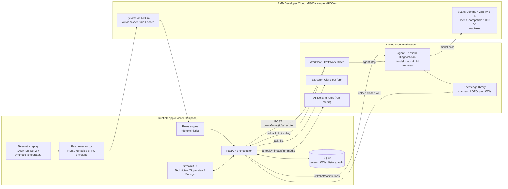

# Truefield: Maintenance Copilot for Factory Technicians

*Truefield turns a vibration spike into a safe, signed-off work order in under two minutes.*

AMD Developer Hackathon ACT III · Track 1 Intelligent Industry · Evolus Business Agents · Google Gemma

Truefield works in four steps:

1. **Detect.** A PyTorch autoencoder (ROCm on AMD MI300X, CPU fallback) plus deterministic physics features (RMS, kurtosis, BPFO envelope energy) flags a failing bearing early, on replayed **NASA IMS Set 2** run-to-failure data.
2. **Explain.** Gemma 4, served by our own vLLM endpoint on AMD and used as the model behind the Evolus agent *Truefield Diagnostician*, explains the likely cause and cites the manual and past work orders. Output is strict JSON.
3. **Draft and gate.** An Evolus workflow drafts a work order. Lockout/tagout (LOTO) steps always come from a **deterministic rules engine** and the LLM can't remove them. High-risk or low-confidence cases need **supervisor approval**.
4. **Close out.** The technician closes the job with a photo, PDF or voice note (Evolus extractor / AI Tool `minutes`). The result becomes structured asset history and is fed back into the knowledge library.

> **Data honesty.** The vibration data is real NASA IMS data once you run the download script. The housing **temperature channel is synthetic** (derived from the vibration RMS) and is labelled that way everywhere. With no dataset downloaded, the app uses a small **synthetic vibration fallback**, and the UI badge says so. The 12 historic work orders and the plant LOTO procedure in `kb/` are synthetic demo documents.

---

## Quickstart (mock mode, no keys, about 2 minutes)

```bash
git clone https://github.com/fozagtx/Truefield && cd Truefield
docker compose up --build
# UI  -> http://localhost:8501     API -> http://localhost:8080/docs
```

With no `.env`, every external call runs in **mock mode**: the diagnosis model, the Evolus workflow, extractor, AI Tools and library. Mock calls are still written to the audit log and labelled `mock` in the UI. On first start the API trains the autoencoder on the CPU (a few seconds) and saves `models/ae-v1.pt`.

**Without Docker:**

```bash
python -m venv .venv && . .venv/bin/activate
pip install --index-url https://download.pytorch.org/whl/cpu torch && pip install -r requirements.txt
uvicorn truefield.api.main:app --port 8080 &
TRUEFIELD_API_URL=http://localhost:8080 streamlit run ui/app.py
pytest -q                       # 44 tests: rules (100% branch coverage), features, schemas, LLM layer, Evolus client, end-to-end API
```

---

## Architecture



| Layer | Module |
|---|---|
| Features (FR-2) | `truefield/anomaly/features.py`: Hilbert envelope of the 2–8 kHz band; energy within ±3 Hz of BPFO 236 / BPFI 297 / BSF 278 / FTF 15 Hz |
| Anomaly model (FR-3) | `truefield/anomaly/{model,train,score}.py`: AE 32→16→4→16→32 on log-FFT bands, trained on the first 40% (healthy); threshold is the p99.5 of the healthy error; 3-snapshot debounce. Device auto-detect: `cuda` (ROCm/HIP or CUDA), else CPU |
| Rules (FR-4) | `truefield/rules/{rules.yaml,engine.py}`: R-SEV-1..4, R-HYP-1..3, R-RISK, R-ROUTE, R-SAFE-1..3, R-PRI |
| LLM (FR-5) | `truefield/llm/{client,diagnose}.py`: OpenAI-compatible (Evolus agent or vLLM direct), schema validation, one repair retry, then `needs_human`; citation docs checked against the library |
| Evolus (FR-6/8/9) | `truefield/evolus/{client,agent,library,workflow,extractor,tools}.py`: timeout + one retry, audit log, mock mode with no key |
| Orchestration | `truefield/pipeline.py`, `truefield/api/main.py`, `truefield/store/db.py`, `truefield/kpi.py` |
| UI | `ui/app.py` (Streamlit) |

**API:** `POST /replay/start?speed=&start_frac=` · `GET /telemetry` · `GET /events` · `POST /events/{id}/diagnose` · `POST /events/{id}/workorder` · `POST /wo/{id}/approve` · `POST /wo/{id}/issue` · `POST /wo/{id}/closeout` (multipart: `source`, `file`, `overrides`) · `POST /callback/evolus` · `GET /kpi` · `GET /bench` · `GET /audit` · `GET /assets/PUMP-07/BRG-1` · `POST /reset`. Interactive docs are at `/docs`.

---

## Safety design

- **Deterministic core, narrow LLM.** Severity, fault hypothesis, risk, routing and LOTO come from `rules.yaml` and `engine.py`: pure Python, 100% branch-covered tests, same input → same output.
- **The LLM can only escalate.** `final.severity = max(rules, llm)`; the same applies to risk. Downgrade attempts are logged as `guardrail_triggered` and counted on the KPI panel.
- **LOTO is always present.** The rules' LOTO entries are merged into every work order, whatever the workflow or LLM returns. Extra LLM LOTO entries are kept only if cited. A work order can't reach `issued` without LOTO.
- **Human gates.** Supervisor approval is required for high risk, confidence < 0.6, a status other than `diagnosed`, LLM disagreement with the rules, or any uncited step (R-ROUTE-1). Technicians can't issue a `pending_approval` work order (HTTP 403). Approve, edit and reject are logged with the user and a timestamp.
- **Grounding.** Diagnoses must cite at least one library document. Citations to unknown documents are dropped, and a diagnosis left with none goes to `needs_human`. Parts not found in the diagnosis are dropped from work orders.
- **Close-out integrity.** `technician`, `root_cause_confirmed`, `actions_done` and `loto_removed_by` are required. The voice parser **never guesses** who removed the locks.
- **Failure handling.** Every external call has a timeout and one retry. If the model is offline, the case goes to the supervisor with a rules-only summary. Workflow 409 or failure → direct agent call with the §13.2 prompt → deterministic draft. With no callback, the app polls every 3 s. `DEMO_CACHE=1` replays recorded responses, labelled *cached*.
- **Never actuates equipment.** Every work order states: *"Draft generated by Truefield. Authorised person must verify isolation before work."*
- **Secrets** live only in env vars (`.env` is git-ignored). No secrets go into workflow parameters, because Evolus stores parameters with the run.

---

## Full setup: AMD + Evolus

### 1. AMD MI300X droplet (ROCm)

```bash
git clone https://github.com/fozagtx/Truefield && cd Truefield
HF_TOKEN=hf_xxx ./deploy/serve_gemma.sh          # vLLM Gemma 4 26B-A4B-it, prints VLLM_API_KEY
# or: docker compose -f deploy/docker-compose.vllm.yml up -d vllm
DATA_DIR=./data ./scripts/download_ims.sh          # 1.08 GB NASA IMS -> data/ims/2nd_test (needs p7zip-full / unrar)
python scripts/make_demo_slice.py --stride 2       # data/demo/ims_set2_b1.npz (real data, not committed)
./deploy/train_rocm.sh                             # trains models/ae-v1.pt on the MI300X, logs the device name, runs bench/ae_bench.py
VLLM_API_KEY=... ./bench/vllm_bench.sh             # vllm bench serve at concurrency 1 and 32
python bench/collect_results.py                    # -> bench/results.json (shown on the Bench tab)
```

Open port 8000 to Evolus (restrict by IP if you can). Never run vLLM without `--api-key`. Fallback models: `google/gemma-4-E4B-it` (fastest) and `google/gemma-4-31B-it`. If attention errors appear on ROCm, set `VLLM_EXTRA_ARGS="--attention-backend TRITON_ATTN"`.

### 2. Evolus event workspace

1. Create the workspace **from the event link** (evolus.ai/en/hackathon).
2. **Your models:** add `gemma4-amd` with base URL `http://<DROPLET_IP>:8000/v1`, model `google/gemma-4-26B-A4B-it`, and API key = `VLLM_API_KEY`. Test the connection.
3. **API key:** create one; the API keys page shows the space ID, which goes into `EVOLUS_APP_ID`.
4. **Knowledge library** `truefield-kb` (language `en`): set `EVOLUS_LIBRARY_ID` and run `python scripts/seed_library.py`. Optionally upload a public bearing-damage guide PDF after checking its licence.
5. **Agent** `Truefield Diagnostician`: model `gemma4-amd`, attach `truefield-kb`, use the system prompt from `truefield/prompts/diagnostician.txt`, and set temperature 0.2 in the agent settings. Get `EVOLUS_AGENT_MODEL` (`<appId>:<agentId>`) from `GET https://api.evolus.ai/v1/models`.
6. **Workflow** `Draft Work Order`: API trigger; parameters `asset_id` and `route`; an agent step with `truefield/prompts/draft_wo.txt`; a condition on `route`; a webhook step. **Turn it on** (otherwise you get a 409). Set `EVOLUS_WORKFLOW_ID`. For callbacks, set `PUBLIC_BASE_URL` (e.g. a cloudflared tunnel) and `TRUEFIELD_CALLBACK_KEY`; otherwise the app polls.
7. **Extractor** `Close-out form`: JSON output with the CloseOut fields (`truefield/schemas/closeout.json`). Set `EVOLUS_EXTRACTOR_ID` and `EVOLUS_EXTRACTOR_AGENT_ID`.
8. Copy `.env.example` → `.env`, fill it in, and run `docker compose up`. The UI badges switch from `mock` to `live`. Optionally run `python scripts/record_demo_cache.py` for a cached backup run (`DEMO_CACHE=1`).

### Environment variables

| Variable | Purpose | Default |
|---|---|---|
| `VLLM_BASE_URL` | vLLM OpenAI-compatible base, e.g. `http://<ip>:8000/v1` (used when `LLM_PROVIDER=vllm`, or `auto` without Evolus) | empty → mock |
| `VLLM_API_KEY` | vLLM `--api-key` | |
| `VLLM_MODEL` | served model name | `google/gemma-4-26B-A4B-it` |
| `HF_TOKEN` | Hugging Face token (droplet only) | |
| `EVOLUS_API_KEY` | Evolus key; empty → all Evolus calls run in mock mode | |
| `EVOLUS_APP_ID` | space ID → `X-Application-Id` | |
| `EVOLUS_AGENT_ID` | Truefield Diagnostician agent ID | |
| `EVOLUS_AGENT_MODEL` | `<applicationId>:<agentId>` for `/v1/chat/completions` | |
| `EVOLUS_LIBRARY_ID` | knowledge library ID | |
| `EVOLUS_WORKFLOW_ID` | Draft Work Order workflow ID | |
| `EVOLUS_EXTRACTOR_ID` / `EVOLUS_EXTRACTOR_AGENT_ID` | close-out extractor and its owning agent | |
| `EVOLUS_REST_BASE` / `EVOLUS_CHAT_BASE` | API bases | `https://api.evolus.ai/api/v1` / `https://api.evolus.ai/v1` |
| `EVOLUS_MINUTES_TOOL` | AI Tool slug for voice notes | `minutes` |
| `LLM_PROVIDER` | `auto` / `evolus` / `vllm` / `mock` | `auto` |
| `PUBLIC_BASE_URL` | public API URL for the workflow `callbackUrl` | empty → polling |
| `TRUEFIELD_CALLBACK_KEY` | checked on `/callback/evolus` (`X-Truefield-Key`) | |
| `DEMO_CACHE` / `DEMO_CACHE_RECORD` | replay / record LLM responses | `0` |
| `COST_PER_HOUR_USD` | downtime cost (Siemens 2024 FMCG) | `36000` |
| `PLANNED_REPAIR_MINUTES` / `UNPLANNED_BASELINE_MINUTES` | illustrative cost-avoided assumptions | `90` / `480` |
| `DATA_DIR` / `MODEL_PATH` | data folder / AE weights | `./data` / `./models/ae-v1.pt` |
| `TRUEFIELD_DATASET` | `auto` / `demo` / `raw` / `synthetic` | `auto` |
| `AUTO_PIPELINE` | event → diagnosis → work order automatically | `1` |
| `MOCK_GUARDRAIL_DEMO` | the mock model tries to downgrade severity (shows the guardrail) | `1` |

### Evolus endpoints still to confirm

Every unverified endpoint shape is isolated in `truefield/evolus/*.py` and marked `TODO: confirm in workspace API reference`:

- the workflow execute **parameters** form field name (`parameters` assumed), and the field that holds the final output in an execution or callback;
- which agent ID owns the extractor, and the `ask-file` response envelope;
- the `import-url` body field and the list-documents envelope;
- AI Tool `run` body field names, and slugs other than `minutes` / `translate` / `anonymize`.

---

## Benchmarks

`bench/results.json` is rendered on the Bench tab and at `GET /bench`. The numbers committed now are a **CPU-only run from the dev box, in mock mode**. Replace them with MI300X numbers from `deploy/train_rocm.sh`, `bench/vllm_bench.sh` and `bench/e2e_latency.py` against the live stack. The autoencoder is deliberately tiny, so CPU inference is already sub-millisecond. The GPU's main job on AMD is serving Gemma 4 and training at scale.

Lead time: `python scripts/eval_leadtime.py` replays the whole record and compares Truefield's first alert with a naive 2× healthy-RMS alarm. On the synthetic fallback, Truefield alerts 15.8 h before the end of the record, against 8.3 h for the naive alarm. **Run it on the real IMS data and quote those numbers instead.**

## Repo layout

```
truefield/  api/ anomaly/ rules/ evolus/ llm/ schemas/ store/ data/ prompts/ pipeline.py kpi.py config.py
ui/app.py            Streamlit UI          kb/        library documents (synthetic plant docs, labelled)
scripts/             download_ims.sh, make_demo_slice.py, seed_library.py, eval_leadtime.py, record_demo_cache.py, make_samples.py
bench/               vllm_bench.sh, ae_bench.py, e2e_latency.py, collect_results.py, results.json
deploy/              serve_gemma.sh, docker-compose.vllm.yml, train_rocm.sh
samples/             close-out form (PDF/JPG/TXT), voice-note transcript
tests/               pytest suite
```

## Data citation

J. Lee, H. Qiu, G. Yu, J. Lin, and Rexnord Technical Services (2007), IMS, University of Cincinnati. "Bearing Data Set", NASA Prognostics Data Repository, NASA Ames Research Center. The data is downloaded by the script and **not redistributed** in this repo.

## License

MIT. See `LICENSE`.
